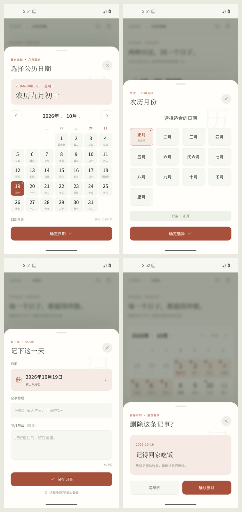

# Solune · 岁时万年历

方便查看农历、节气、节假日与日期记事的日历应用。英文名 **Solune**，中文名 **岁时万年历**。

这个仓库统一管理各个平台的源码和版本。当前上传基线为 Android **v1.2.0**，Windows 桌面端尚待开发。

| 平台 | 状态 | 工程目录 |
| --- | --- | --- |
| Android | 已实现 v1.2.0，支持 Android 8.0 及以上 | [apps/android](apps/android) |
| Web | 已实现基础网页/PWA，可在浏览器运行 | [apps/web](apps/web) |
| Windows | 预留目录，尚未实现桌面客户端 | [apps/windows](apps/windows) |

## Android 当前功能

- 公历 1901—2100 年月历、农历、干支、生肖、节气与节日。
- 公农历双向转换，支持农历闰月。
- 放假“休”、补班“班”标记；公开假日接口自动更新、手动刷新和本机缓存。
- 日期记事保存在本机，农历与记事可以离线使用。
- 月历左右滑动、深浅色主题、沉浸式底部导航。
- 日期、农历选择、记事、删除确认、帮助等统一网格/卡片弹窗。



## 工程结构

```text
apps/
  android/        Android 原生容器、离线资源、假日接口和设备回归检查
  web/            基础网页/PWA 源码及日历数据
  windows/        Windows 桌面端预留目录
docs/
  assets/         界面预览
```

各客户端的农历计算均基于 `lunar-javascript`。Android 已有独立的界面增强、假日更新与原生存储；Web 是基础版本，暂不包含这些 Android 专用功能。Windows 开发时可继续复用现有前端和历法代码。

## 开发与构建

### Android

使用 Android Studio 打开 `apps/android`，配置 JDK 17 和 Android SDK 35。

```sh
cd apps/android
./gradlew :app:assembleDebug
```

Windows 命令行为 `gradlew.bat :app:assembleDebug`。工程已包含完整离线资源，无需先启动网页。详见 [Android 工程说明](apps/android/README.md)。

### Web

在仓库根目录执行：

```sh
python3 -m http.server 5173 --directory apps/web/dist
```

打开 <http://localhost:5173>。也可将 `apps/web/dist` 部署到静态站点服务。

### 校验历法与假日数据

```sh
cd apps/android
node verify-holidays.cjs
```

既有版本的 37 项 Android 模拟器回归，以及键盘、真实接口、离线缓存和覆盖升级记录，见 [v1.2.0 验证记录](apps/android/VALIDATION-v1.2.0.md)。

## 版本与签名

- 各平台源码在同一个仓库维护；安装包后续通过 GitHub Releases 分发。
- Android 包名保留 `cn.suishi.calendar`，以延续已有版本和记事数据。
- 签名密钥、密码、本机 SDK 配置、构建缓存和测试代理不进入公开仓库。
- 既有正式 APK 覆盖升级必须使用原签名。原签名材料仍保留在原本地工程中；新开发环境需由维护者单独配置。
- Windows 目前没有可安装版本，后续实现与发布状态在其工程目录维护。

## 数据来源与许可

历法数据来自 [lunar-javascript](https://github.com/6tail/lunar-javascript)，随仓库保留其 [MIT 许可](apps/web/dist/vendor/LICENSE-lunar.txt)。Android 假日安排通过[提莫公开接口](https://timor.tech/api/holiday/)获取，未公布或未收录年份不推算调休。

主工程目前未指定开源许可证；公开托管不改变第三方库的许可条款。
